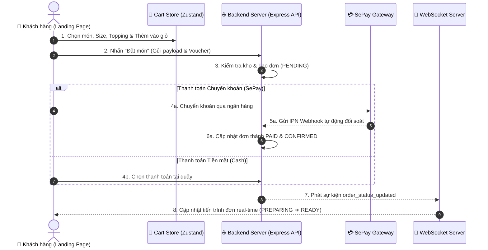

# 📱 SipPoint - Customer Web App (Landing Page)

[](https://react.dev/)
[](https://vitejs.dev/)
[](https://tailwindcss.com/)
[](https://reactrouter.com/)
[](https://tanstack.com/query/latest)
[](https://zustand-demo.pmnd.rs/)
[](https://socket.io/)
[](https://vercel.com/)

Ứng dụng **Web App Đặt món & Tích điểm Khách hàng** thuộc hệ sinh thái chuỗi cà phê & trà sữa **SipPoint Coffee & Tea**. Được thiết kế chuẩn **Mobile-First UX/UI**, mang lại trải nghiệm đặt hàng thông minh, theo dõi đơn hàng thời gian thực, tích điểm đổi quà và tương tác với Trợ lý AI tư vấn đồ uống.

---

## 🌐 1. Luồng Trải nghiệm Đặt hàng & Kết nối Real-time



---

## 🌟 2. Chi tiết Phân hệ Tính năng (Feature Breakdown)

### ☕ 2.1. Thực đơn & Đặt món Thông minh (`src/features/menu`)
- **Tối ưu Mobile Touch**: Giao diện chạm, vuốt mượt mà trên di động.
- **Tìm kiếm & Lọc danh mục**: Tìm kiếm tức thì theo tên món, lọc theo từng danh mục (Cà phê, Trà sữa, Đá xay...).
- **Tùy chỉnh món uống chi tiết**:
  - Chọn kích thước: Size Medium (M) / Large (L).
  - Chọn Toppings phong phú: Trân châu đen, Thạch trái cây, Cream cheese...
  - Ghi chú riêng cho pha chế (VD: *Ít đường, nhiều đá, không béo*).

### 🛒 2.2. Quản lý Giỏ hàng & Checkout (`src/features/cart`)
- **Quản lý Giỏ hàng (Zustand Store)**: Lưu trữ giỏ hàng local storage, cập nhật số lượng tức thời.
- **Kiểm tra tồn kho thời gian thực**: Tự động xác thực số lượng khả dụng với Backend trước khi đặt món.
- **Mã giảm giá & Ví Voucher**:
  - Áp dụng mã khuyến mãi nhập tay (`voucherCode`).
  - Chọn trực tiếp voucher trong ví cá nhân (`customerVoucherId`).
- **Thanh toán linh hoạt**:
  - **Chuyển khoản Ngân hàng (SePay)**: Tích hợp cổng SePay tự động đối soát tiền chuyển khoản qua IPN.
  - **Tiền mặt tại quẹt (CASH)**: Thanh toán trực tiếp cho thu ngân.

### ⏱️ 2.3. Theo dõi Đơn hàng Thời gian thực (`src/features/orders`)
- **Kết nối WebSockets (Socket.io-client)**: Tự động cập nhật trạng thái đơn hàng thời gian thực không cần tải lại trang.
- **Các mốc tiến trình đơn**: `PENDING` ➔ `CONFIRMED` ➔ `PREPARING` ➔ `READY` ➔ `COMPLETED`.
- **Hóa đơn điện tử (`PaymentReceiptSheet`)**: Xem chi tiết món đã đặt, tổng tiền, mã giảm giá và trạng thái thanh toán.

### 🎁 2.4. Tích điểm Loyalty & Gamification (`src/features/rewards`)
- **Tích điểm SipPoints**: Tự động tích lũy điểm thưởng sau mỗi đơn hàng hoàn tất.
- **Thẻ Hạng Hội viên**: Hiển thị tiến trình nâng hạng (Đồng ➔ Bạc ➔ Vàng ➔ Kim Cương) cùng đặc quyền giảm giá tương ứng.
- **Vòng quay May mắn (Lucky Wheel)**: Trò chơi quay thưởng tương tác nhận voucher và điểm thưởng với hoạt họa mượt mà.
- **Ví Voucher Cá nhân**: Quản lý tập trung toàn bộ mã giảm giá trúng thưởng hoặc đổi từ điểm.

### 🤖 2.5. Trợ lý AI Tư vấn Đồ uống (`src/features/ai`)
- **AI Chatbot Modal**: Tích hợp **Google Gemini 2.5 Flash RAG Engine**.
- **Tư vấn thông minh**: Gợi ý món uống theo thời tiết, tâm trạng, chế độ ăn uống và thông tin thực đơn mới nhất.

---

## 📁 3. Cấu trúc Cây Thư mục Dự án

```
SipPoint-Landing-Page/
├── public/               # Asset tĩnh, Favicon, Web Manifest
├── src/
│   ├── apis/             # Các hàm gọi API Backend (Axios Client)
│   ├── components/       # UI Components dùng chung (Header, Navigation, Sheets)
│   ├── constants/        # Route paths, ENUMs, App Constants
│   ├── contexts/         # React Context (Theme, App Contexts)
│   ├── features/         # Cấu trúc Modules Tính năng (Feature-driven Architecture)
│   │   ├── ai/           # AI Drink Assistant Chatbot Modal
│   │   ├── auth/         # Đăng nhập, Đăng ký, Quên mật khẩu
│   │   ├── cart/         # Giỏ hàng, Tính tiền, Checkout & Voucher
│   │   ├── menu/         # Thực đơn, Chi tiết món, Chọn Size & Topping
│   │   ├── orders/       # Danh sách đơn hàng, Realtime Tracking, Hóa đơn
│   │   ├── profile/      # Hồ sơ khách hàng, Lịch sử tích điểm
│   │   └── rewards/      # Vòng quay may mắn, Ví Voucher, Thẻ hội viên
│   ├── helpers/          # Hàm tiện ích (Format currency, date time)
│   ├── hooks/            # Custom React Hooks
│   ├── pages/            # Page Container Components
│   ├── routes/           # Cấu hình Router & Protected Routes
│   ├── services/         # Socket.io Client Connection Manager
│   ├── stores/           # State Management (Zustand Cart & User Stores)
│   ├── App.jsx           # Root Component
│   ├── index.css         # Import TailwindCSS v4 & Custom Utilities
│   └── main.jsx          # Entry point
├── .env                  # Cấu hình biến môi trường
├── vercel.json           # Cấu hình Vercel SPA Routing Rewrites
├── vite.config.js        # Cấu hình Vite Builder
└── package.json          # Package Dependencies & Build Scripts
```

---

## 🛠️ 4. Công nghệ & Thư viện Sử dụng

- **Core Framework**: React 19, Vite 6 (JavaScript).
- **Styling**: TailwindCSS v4, Custom Vanilla CSS animations.
- **State Management**: **Zustand** (Store lưu trữ giỏ hàng `sippoint_cart` & trạng thái Auth).
- **Data Fetching & Caching**: **TanStack Query (React Query v5)** & Axios Interceptors.
- **Client Routing**: React Router v7.
- **Real-time WebSockets**: Socket.io-client v4.
- **Notification & UI**: Sonner Toast, Lucide Icons, Radix UI primitives.

---

## ⚙️ 5. Cấu hình Biến môi trường (`.env`)

Tạo file `.env` ở thư mục gốc:

```env
# URL API Backend Server (Local / Production)
VITE_APP_API_URL=http://localhost:5000/api/v1
```

---

## 💻 6. Hướng dẫn Khởi chạy Môi trường Local

### 1. Cài đặt Dependencies
```bash
npm install
```

### 2. Chạy Môi trường Development
```bash
npm run dev
```
Ứng dụng sẽ khởi chạy tại: `http://localhost:5173`.

---

## 🚀 7. Triển khai Production (Vercel)

Dự án đã tích hợp sẵn tệp cấu hình [vercel.json](file:///d:/Documents/FULLSTACK_MERN/SipPoint-Landing-Page/vercel.json):

```json
{
  "rewrites": [
    { "source": "/(.*)", "destination": "/index.html" }
  ]
}
```

- **Build Command**: `npm run build`
- **Output Directory**: `dist`
- **Tác dụng**: Cấu hình rewrite này giúp chuyển hướng toàn bộ các route client về `index.html`, triệt tiêu hoàn toàn lỗi **`404: NOT_FOUND`** khi reload (F5) hoặc truy cập trực tiếp các đường dẫn sâu trên Vercel.
